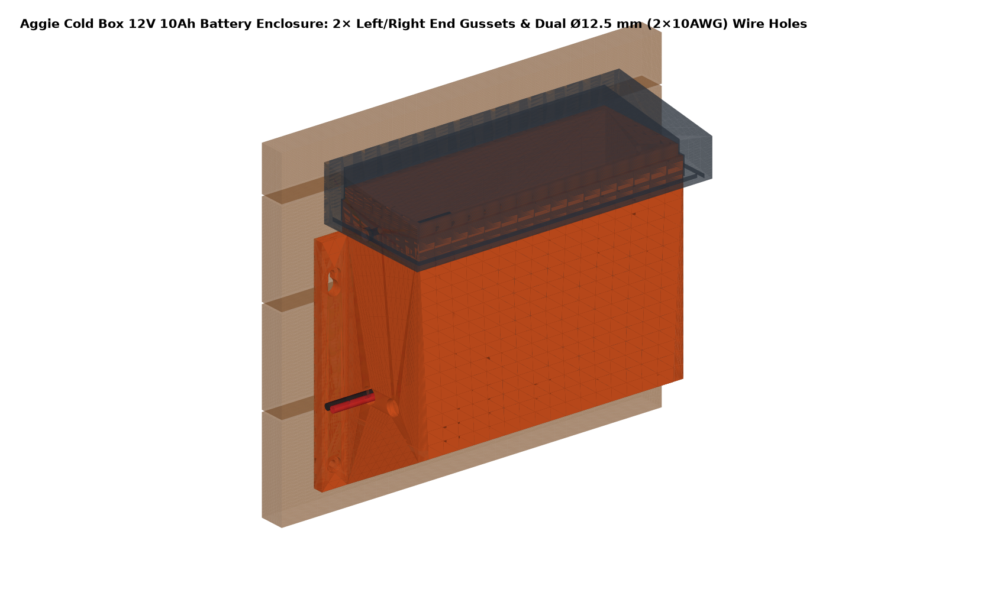
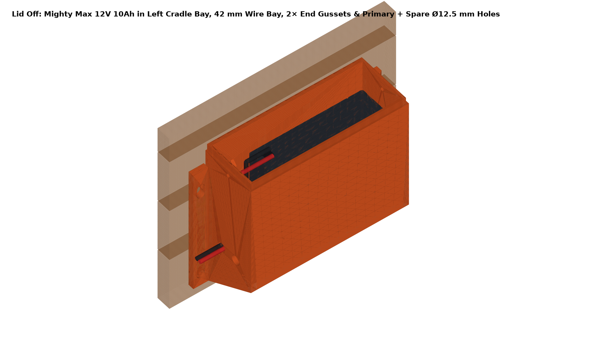
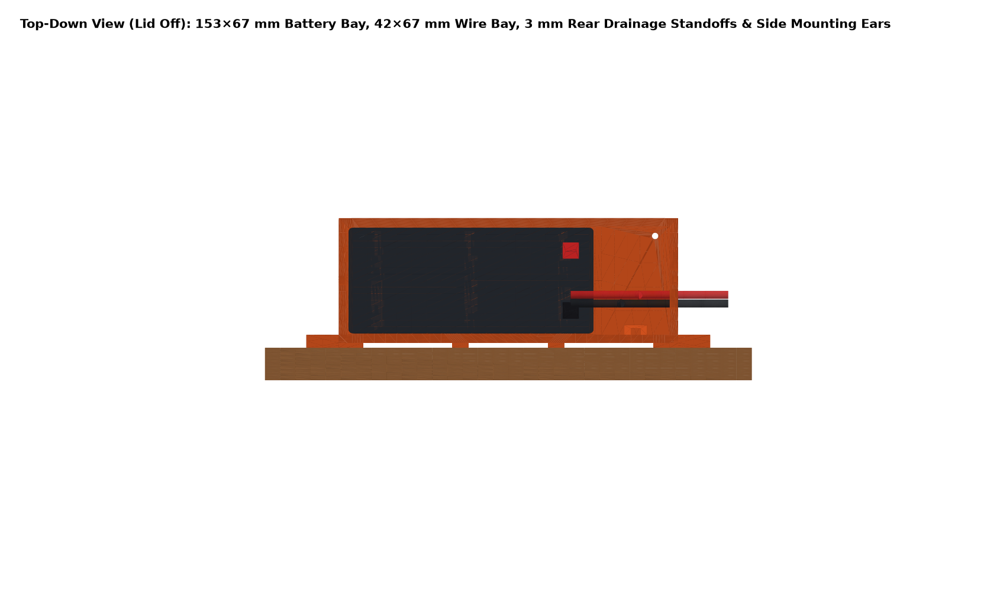
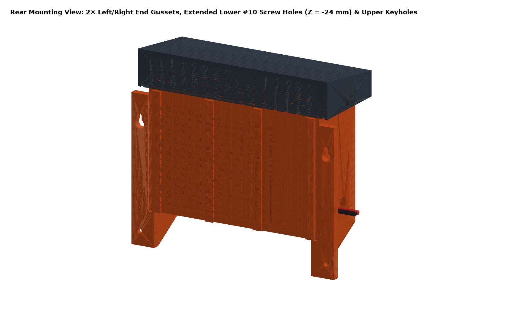
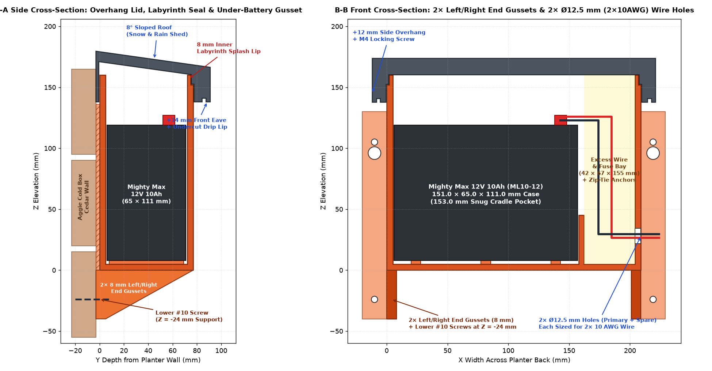
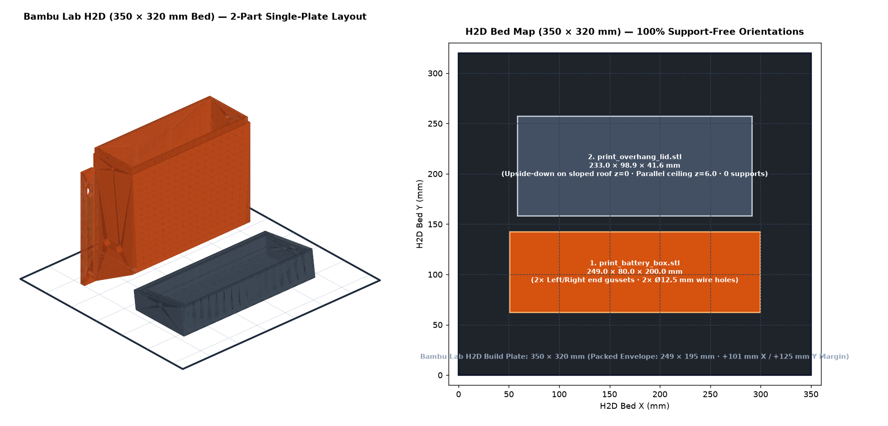

# Aggie Cold Box 12V 10Ah Battery Enclosure

**Planters:** (3) Backyard Discovery *Aggie Cold Box* Cedar Planters  
**Battery:** (1) Mighty Max `ML10-12` 12V 10Ah SLA Battery (`151.0 × 65.0 × 111.0 mm` case, `119.0 mm` over F2 spade terminals)  
**Load:** (2) `200 mm` 12V RVMARINEPAT Linear Actuators lifting the cold box lid via a toggle switch (`2 × 10 AWG` leads)

| | |
|---|---|
|  |  |
|  |  |



---

## 1. Design Highlights & Weatherproofing

| Feature | Engineering Specification |
|---|---|
| **Snow & Rain Overhang Lid (`print_overhang_lid`)** | **8° forward-sloped shed roof** (`Z = 179.6 mm` at back wall down to `Z = 166.4 mm` at front eave) so snow and rain slide forward away from the planter. Generous **`+12.0 mm` side eaves** and **`+14.0 mm` front eave overhang** with a **`22.0 mm` deep overlap skirt** (`Z = 138..160 mm`). |
| **Undercut Drip Edge + Labyrinth Splash Lip** | The underside of the lid eave features a continuous **`3.2 × 3.0 mm` undercut perimeter drip groove** inside a `3.5 mm` projecting outer drip bead so water drips cleanly off the bottom rim without wicking inward. Inside the lid, the top rim of the box steps inward to form an **`8.0 mm` tall raised inner labyrinth splash lip** (`Z = 152..160 mm`). |
| **2× Left & Right Under-Box Gussets + Extended Lower Cold-Box Mounts** | Only **2 triangular under-box gussets** (`8.0 mm` thick, one on the left end at `X = 0..8 mm` and one on the right end at `X = 201..209 mm`) extend **`40.0 mm` below the box floor (`Z = -40.0 .. 0.0 mm`)** to brace the full `77.0 mm` depth of the enclosure without cluttering the middle of the floor. The left and right mounting flanges extend down to `Z = -40.0 mm` alongside the two gussets and place the **2 lower `#10` wood-screw mounting holes at `Z = -24.0 mm`** below the battery floor. |
| **Dedicated Excess Wire & Fuse Stuffing Bay** | Alongside the snug **`153.0 × 67.0 mm` Battery Cradle Bay** (which locks the `151 × 65 mm` Mighty Max battery behind a `40 mm` tall internal divider rib so it cannot slide), the right side of the box provides a **`42.0 × 67.0 × 155.0 mm` Wire-Stuffing Bay** (`435 cm³`) plus **`33.0 mm` of full-width overhead headroom** (`439 cm³`) above the F2 terminals and **`2×` internal zip-tie anchor bridges** on the back wall. |
| **Dual Large `Ø12.5 mm` (`2 × 10 AWG`) Wire Gland Holes (Primary + Spare)** | Located low on the right side wall (`Z = 28.0 mm`), **one large `Ø12.5 mm` (`~1/2"`) primary hole** (`Y = 27.0 mm`) takes both `10 AWG` actuator leads together (`2 × 10 AWG`), and **an identical `Ø12.5 mm` spare hole** sits right next to it (`Y = 51.0 mm`, `24.0 mm` center-to-center) ready to take a second `2 × 10 AWG` wire pair. |
| **Aggie Cold Box Cedar Back-Wall Mounting** | Left and right **`20.0 mm` wide × `8.0 mm` thick mounting flanges** (`229.0 mm / 9.0 in` horizontal screw spacing, `Z = -40..130 mm`) provide **`2×` upper drop-on keyhole slots** (`Z = 96/105 mm`) and **`2×` extended lower screw holes** (`Z = -24 mm`, right beside the 2 bottom gussets) for `4 × #10` stainless wood screws. Four **`3.0 mm` rear drainage standoff ribs** (`Z = 0..136 mm`) let rain and snowmelt run freely down the cedar planter wall behind the box, while `3.0 mm` internal floor ribs and `2 × Ø4.0 mm` floor weep holes keep the battery dry. |

---

## 2. Reviewing the Model in Autodesk Fusion 360

You can open and review the parametric assembly in **Autodesk Fusion 360** in either of two ways:

### Option A: Run the Native Parametric Fusion Script (Recommended)
1. In Autodesk Fusion, press **`Shift + S`** (*Utilities → Scripts and Add-Ins*).
2. Under **My Scripts**, select **`AggieBatteryBox`** (already linked into your Fusion `API/Scripts` folder, or click **`+`** and select [`cad/AggieBatteryBox`](cad/AggieBatteryBox)) and click **Run**.
3. The script generates a new parametric design (`Aggie_Cold_Box_12V_10Ah_Battery_Enclosure`) in millimeters with **4 toggleable sub-components** in the Browser tree:
   - `00_Aggie_Cold_Box_Planter_Wall` — Cedar back wall planks
   - `01_Battery_Box_Enclosure` — Main 3D-printed enclosure body (with 5× under-battery gussets, extended lower mounting holes, and direct 10AWG wire holes)
   - `02_Weatherproof_Overhang_Lid` — Sloped overhang drip lid
   - `03_MightyMax_12V_10Ah_And_Wiring` — Mighty Max ML10-12 battery, F2 spade terminals, and 2× 10 AWG leads
4. Open **Modify → Change Parameters** in Fusion to inspect all registered user parameters (`BATT_LEN_X`, `WIRE_BAY_W_X`, `OVERHEAD_WIRE_H_Z`, `UNDER_GUSSET_H_Z`, `LID_OVERHANG_SIDE_X`, `LID_OVERHANG_FRONT_Y`, `WIRE_HOLE_DIA`, etc.).

### Option B: Open the Multi-Body STEP Assembly Directly
- In Autodesk Fusion, choose **File → Open → Open from my computer** and select:
  - [`cad/step/aggie_cold_box_battery_assembly.step`](cad/step/aggie_cold_box_battery_assembly.step)

---

## 3. Bambu Lab H2D (`350 × 320 × 325 mm`) Print Plates & STLs (`stl/`)



Both parts are **100% support-free** (`≤ 45°` overhangs, verified by [`cad/plates.py`](cad/plates.py)) and pre-oriented flat on `Z = 0` for the **Bambu Lab H2D (`350 × 320 × 325 mm` bed)** — load directly into Bambu Studio and slice without rotating or enabling supports:

### H2D Build Plate & Individual Pre-Oriented Part STLs
| STL File | Footprint on H2D Bed (`X × Y × Z`) | Bed Contact / H2D Margin | Support-Free Orientation Details |
|---|---|---|---|
| **[`stl/plate_h2d_all_in_one.stl`](stl/plate_h2d_all_in_one.stl)** | `249.0 × 194.9 × 200.0 mm` | `+101 mm X`, `+125 mm Y` | **Complete 1-plate print:** Both `print_battery_box` and `print_overhang_lid` arranged together on the `350 × 320 mm` H2D build plate. |
| **[`stl/print_battery_box.stl`](stl/print_battery_box.stl)** | `249.0 × 80.0 × 200.0 mm` | `448 mm²` (`+101 mm X`, `+240 mm Y`) | Main enclosure with 2× Left/Right end gussets (`Z = -40..0 mm`), extended lower mounting holes (`Z = -24 mm`), and 2× `Ø12.5 mm` (`2 × 10 AWG`) right-wall wire holes. |
| **[`stl/print_overhang_lid.stl`](stl/print_overhang_lid.stl)** | `233.0 × 98.9 × 41.6 mm` | `22,111 mm²` (`+117 mm X`, `+221 mm Y`) | Flipped upside-down onto its flat sloped outer roof (`Z = 0`). The inner ceiling (`Z = 6.0 mm`) is parallel to the sloped roof so the H2D prints a flat `6.0 mm` solid roof slab with zero bridging or stair-stepping, then grows the labyrinth collar and undercut drip groove straight up. |

- **Recommended Filament:** **ASA** or **PETG** (UV- and weather-resistant for outdoor snow/sun exposure)
- **Bambu Studio H2D Settings:** `0.4 mm` nozzle, `0.20 mm` layer height, **4 wall loops**, **5 top/bottom shell layers**, **25% gyroid infill**, **Supports: OFF**, **Outer Brim: 8 mm** on `print_battery_box.stl` (anchors the gusset feet and lower apron firmly to the PEI sheet).

---

## 4. Hardware BOM (Per Box)

| Qty | Fastener / Hardware | Location | Notes |
|---|---|---|---|
| `2` | **M4 Tapered Heat-Set Inserts** (`McMaster 94180A353`, `Ø5.6 mm` bore) | `2×` upper box side walls (`Z = 145 mm`) | Zero loose nuts |
| `2` | **M4 × 14 mm Stainless Button-Head Screws** (`ISO 7380`) | `2×` Overhang Lid side lock screws | 316 or 18-8 stainless |
| `4` | **`#10 × 1-1/4"` Stainless Pan-Head Wood Screws** | `2×` upper drop-on keyholes (`Z = 105 mm`), `2×` extended lower support holes below battery floor (`Z = -24 mm`) | Threads into Aggie Cold Box cedar back planks (`20 mm` thick) |
| `2–3` | **UV-Black Nylon Zip Ties (`4 mm` wide)** | Internal back-wall zip-tie anchor bridges in the wire-stuffing bay | Secures excess `10 AWG` actuator wire & inline fuse |

---

## 5. Rebuilding CAD, Renders & Interactive 3D Viewer

```bash
cd aggie-cold-box-battery/cad
python3 -m venv .venv && .venv/bin/pip install -r requirements.txt

# Build parametric assembly, run 3D solid clash check (0.00 mm³), export STEP, STLs & viewer JSON:
.venv/bin/python box.py --clash

# Regenerate shaded orthographic/isometric PNGs and cross-section diagram:
MPLCONFIGDIR=/tmp/mpl .venv/bin/python render.py

# Launch interactive 3D web viewer locally at http://localhost:8000:
cd ../viewer && python3 -m http.server 8000
```
